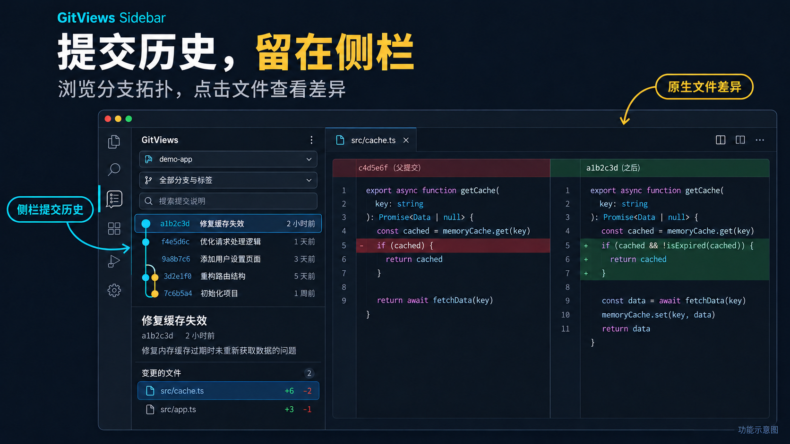
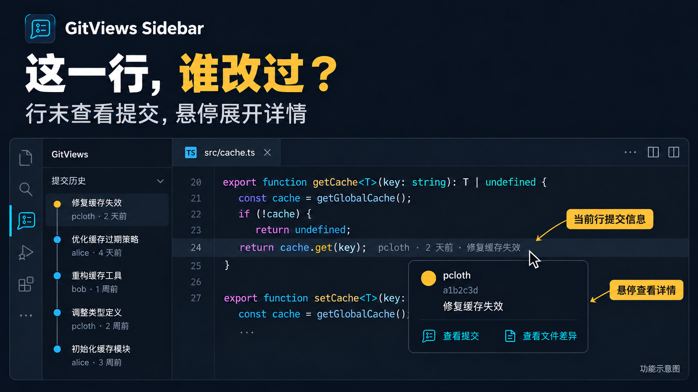
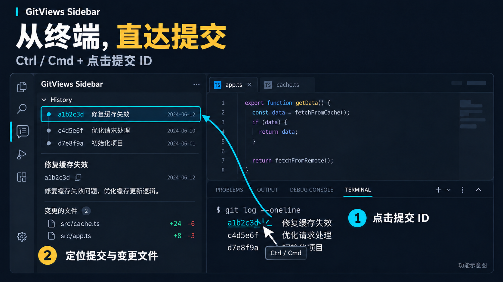

# GitViews Sidebar

GitViews Sidebar 将 Git 提交历史放在 VS Code 主侧栏，并通过当前行 blame 和终端提交 ID 快速定位修改。

## 功能

- **侧栏历史**：活动栏的 GitViews 图标打开提交拓扑图；Ctrl+B 控制主侧栏显隐（macOS 默认 Cmd+B）。支持分支/标签筛选、提交说明与作者搜索、分页、SHA 定位。
- **提交详情**：查看完整说明、作者、时间和变更文件；点击文件使用 VS Code 原生差异编辑器。支持合并提交选择父提交、根提交、重命名、删除及二进制文件标记。
- **提交比较**：选中提交并设为比较起点，再选另一个提交点击比较；比较的是两个提交的完整快照。也可运行 `GitViews: 比较提交…` 输入两个 SHA。
- **当前行 blame**：行末显示作者、相对时间和摘要；悬停查看完整说明，并跳到侧栏或对应文件的历史差异。未保存编辑参与计算，尚未提交的行有单独提示。
- **终端提交链接**：在 VS Code 内置终端运行 `git log`、`git log --oneline` 或 `git log --graph --oneline --all`，按 VS Code 提示使用 Ctrl/Cmd+点击提交 ID，侧栏会展示该提交及其变更文件。

历史默认包含本地已有的全部分支、远程引用和标签，不自动 fetch。若跳转目标不在已加载列表中，会显示以目标提交为起点的祖先历史，点击“返回”恢复原筛选与历史。搜索针对完整历史中的提交说明和作者；查找 SHA 使用工具栏的 `#`。

## 功能示意

### 提交历史，留在侧栏

在左侧浏览分支拓扑与提交详情，点击变更文件，用原生差异编辑器查看修改。



### 这一行，谁改过？

当前行末显示作者、时间与提交摘要；悬停展开详情，可跳转到提交或对应文件差异。



### 从终端，直达提交

在内置终端按 Ctrl/Cmd 点击提交 ID，打开侧栏并定位提交，展示详情及变更文件列表。



## Windows 开发与安装（Volta + pnpm）

要求 VS Code **1.100.0 或以上**、系统已安装 Git。工具链固定在 `package.json`：

| 工具 | 版本 |
| --- | --- |
| Node.js | 22.22.3 |
| pnpm | 10.11.0 |

Volta 的 pnpm 支持需要 `VOLTA_FEATURE_PNPM=1`，参见 [Volta 官方说明](https://docs.volta.sh/advanced/pnpm)。首次配置时在 PowerShell 运行：

```powershell
[Environment]::SetEnvironmentVariable("VOLTA_FEATURE_PNPM", "1", "User")
$env:VOLTA_FEATURE_PNPM = "1"
volta install node@22.22.3
volta install pnpm@10.11.0
```

进入本项目目录后，Volta 会按项目配置选择版本：

```powershell
node --version
pnpm --version
pnpm install --frozen-lockfile
pnpm check
pnpm test
pnpm build
```

在 VS Code 中打开项目并按 **F5**，启动扩展开发窗口，在新窗口打开一个真实 Git 仓库测试。也可以打包安装：

```powershell
pnpm package
code --install-extension .\gitviews-sidebar-1.0.2.vsix
```

如果没有配置 `code` 命令，使用扩展页右上角菜单中的“从 VSIX 安装”。插件标识为 `pcloth.gitviews-sidebar`，商店展示名称为 `GitViews Sidebar`。发布到 Marketplace 后，可使用 `GitViews` 搜索，或通过完整标识查找。

原商店条目已删除，因此使用新的内部名称和展示名称重新发布。若本机安装过先前的测试包（`git-views-local.git-views`、`pcloth.git-views` 或 `pcloth.pcloth-gitviews`），请先卸载它们并重载窗口，以免重复的历史面板入口冲突。今后在新商店条目中使用 Update 更新版本。

macOS/Linux 同样使用 `pnpm install --frozen-lockfile`；使用 Volta 时在 shell 配置中设置 `export VOLTA_FEATURE_PNPM=1`。

## 配置与命令

| 配置 | 默认值 | 说明 |
| --- | --- | --- |
| `gitViews.blame.enabled` | `true` | 当前行末提交信息 |
| `gitViews.blame.template` | `${author}, ${dateAgo} • ${subject}` | 支持 `${author}`、`${dateAgo}`、`${date}`、`${subject}`、`${sha}` |
| `gitViews.history.pageSize` | `200` | 每次加载数量，20–1000 |
| `gitViews.terminalLinks.enabled` | `true` | 内置终端提交链接 |

可通过主题颜色 `gitViews.blameForeground` 调整行内信息颜色。命令面板提供打开历史、定位提交、刷新、比较提交和切换 blame。界面根据 VS Code 语言显示简体中文或英文。

若已启用 `git.blame.editorDecoration.enabled`，插件会提示一次，提供关闭内置装饰的操作；也可以手动关闭以避免重复显示。GitLens 等其他插件的行内信息需要在对应插件中关闭。

## 边界与诊断

- 第一版仅提供读取与比较；不会执行 checkout、commit、merge、rebase、reset 或远程写操作。所有 diff 均为只读历史文档。
- 支持本地和 VS Code Remote WSL/SSH 工作区，Git 在扩展宿主所在机器运行。需在远程环境安装本插件并确保 Git 可用。
- 不支持纯浏览器虚拟仓库、独立外部终端，也不支持在普通内置终端中手动 SSH 到另一台机器后直接识别远端仓库。
- 终端链接使用至少 7 位十六进制 SHA；点击后验证对象。目录信息不可用时搜索已打开仓库，有多个候选时选择仓库。过短、歧义或不存在的提交会提示重新提供 ID。
- 未跟踪文件和空仓库没有历史 blame；超过 2 MiB、50,000 行或含二进制 NUL 的文档跳过 blame。Git 查询有 30 秒超时和 32 MiB 输出上限。
- 二进制文件显示类型提示，不提供文本差异。历史文本按 UTF-8 解码；未加入 Git 的 LFS 大文件内容不会自动下载。
- 浅克隆中缺失的父对象会使相应比较失败；需要先在终端补全历史。
- 错误可在“输出 → Git Views”中查看。未发送遥测，不依赖云服务。

## 验证

`pnpm test` 在系统临时目录创建并清理真实 Git 仓库，覆盖历史拓扑与分页、筛选、完整提交信息、根/合并提交、SHA 验证、重命名、Unicode/特殊路径、二进制检测、未保存内容 blame、取消请求、空仓库及 SHA-256 仓库。

界面与远程环境的人工验收步骤见源码中的 `test/MANUAL.md`。

## 结构

`src/core` 负责不依赖 VS Code 的 Git 查询、拓扑布局和 SHA 扫描；扩展宿主负责仓库生命周期、命令、blame、终端和虚拟文件。`media` 提供使用本地资源和严格 CSP 的侧栏，提交说明与文件名均作为文本渲染。
